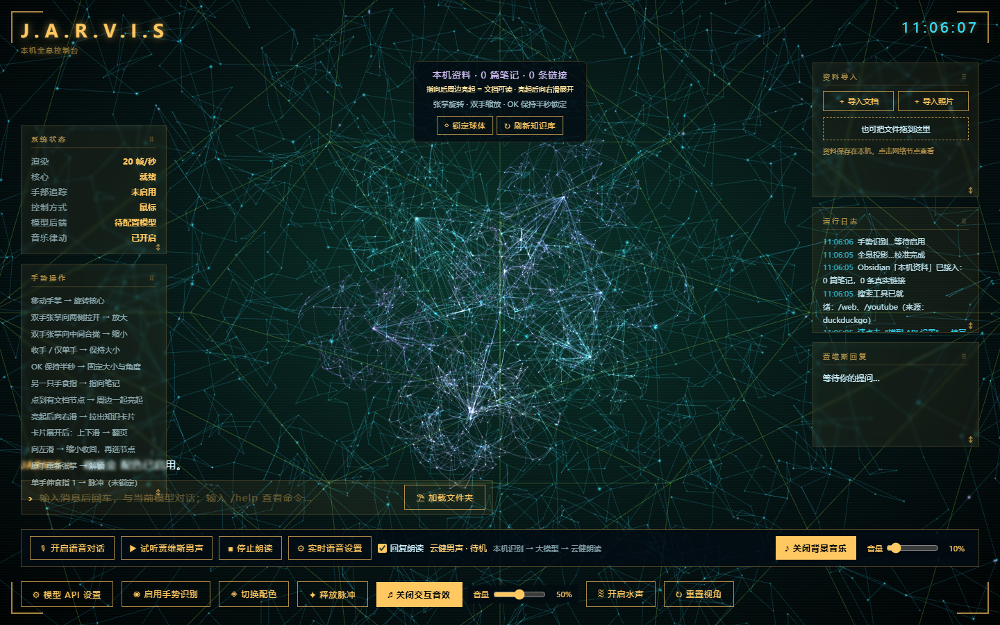

<div align="center">

# J.A.R.V.I.S · Neural Desktop

**用手势操控全息神经网络，把模型对话、实时语音和个人资料放进同一个桌面。**

[下载 Mac 版](https://github.com/zhuge661/jarvis-neural-desktop/releases/tag/v1.0.0) · [安装说明](#安装-mac-版) · [从源码运行](#从源码运行) · [隐私与数据](#隐私与数据) · [上游与许可证](#上游与许可证)


</div>



## 可以做什么

- **全息神经网络**：多层节点、连线、流动信号与能量脉冲，随语音状态和操作产生动态反馈。
- **摄像头手势控制**：双手张掌拉开放大、合拢缩小；OK 手势锁定；双手张掌可重新接管缩放。
- **资料光点**：导入文档和照片后，在网络里显示为光点。锁定球体、指向光点，向右拖出阅读卡片，向左拖回。
- **可调整的卡片**：资料导入、运行日志、系统状态和回复卡均可拖动；拖动右下角可调整高度。
- **逐字回复**：右下角显示完整回答，并带闪烁光标。
- **自选模型 API**：支持 OpenAI 兼容 Chat Completions / Responses、Anthropic Messages、Gemini 和本地 Ollama。
- **实时语音**：配置自己的火山语音 API 后，直接使用实时模型的音频输出，支持插话。
- **可选离线识别**：Vosk 中文识别可在本机运行，回答由所配置模型生成，微软云健在线朗读。

神经网络部分是一种 3D 交互视觉表现。模型、声音和摄像头权限均由使用者自行配置。

## 安装 Mac 版

需要 **macOS 13 或更新版本**。在苹果菜单的“关于本机”中查看芯片类型：

| 你的 Mac | 下载文件 |
|---|---|
| Apple 芯片 / M 系列 | [Jarvis-macOS-arm64-v1.0.0.zip](https://github.com/zhuge661/jarvis-neural-desktop/releases/download/v1.0.0/Jarvis-macOS-arm64-v1.0.0.zip) |
| Intel 芯片 | [Jarvis-macOS-x64-v1.0.0.zip](https://github.com/zhuge661/jarvis-neural-desktop/releases/download/v1.0.0/Jarvis-macOS-x64-v1.0.0.zip) |

1. 完整解压对应 ZIP。
2. 双击包内的 **`首次安装.command`**。它将程序复制到你个人的 `~/Applications/贾维斯.app`，使用 macOS 自带工具完成本地签名并校验，然后启动。
3. 以后直接打开“贾维斯.app”。程序自带 Python 和所需依赖，无需另外安装 Python、Node 或 OpenClaw。
4. 点击“模型 API 设置”，填写自己的连接；点击“实时语音设置”配置自己的语音 API。
5. 使用手势时允许摄像头，使用语音时允许麦克风。

这是**技术预览版**。安装包没有 Apple Developer ID 签名或苹果公证；首次打开可能需要按照 macOS“隐私与安全性”提示确认来源。不要关闭系统安全防护。Mac 自动构建与启动检查的结果见 [Actions](https://github.com/zhuge661/jarvis-neural-desktop/actions)；摄像头识别手感、麦克风与真实云端语音仍需要在你的设备上体验。

安装包旁提供 SHA256 校验值；[版本页](https://github.com/zhuge661/jarvis-neural-desktop/releases/tag/v1.0.0)列出本次验证范围。

## 配置模型和声音

### 模型 API

在“模型 API 设置”中填写：

| 字段 | 如何填写 |
|---|---|
| 连接名称 | 自己容易辨认的名称 |
| 接口协议 | 与服务商提供的接口匹配 |
| API 基础地址 | 服务商给出的 Base URL；通常不要追加 `/chat/completions` 等具体接口路径 |
| 模型 ID | 服务商提供的完整模型名称 |
| API Key | 你自己的 Key；本地无鉴权服务可勾选“此服务不需要 Key” |

保存后发送一条消息验证连接。程序不会附送 API 额度，也没有内置任何人的账号或密钥。

### 语音

- **实时模式**：在“实时语音设置”填写自己的火山实时语音 API Key。声音直接来自实时模型；配置失败会显示错误。
- **离线识别 + 在线朗读**：关闭实时模式后，使用本机 Vosk 中文识别、所选模型 API 和微软云健朗读。云健朗读需要网络。
- **内置唤醒短句**：少量固定回复使用包内通用合成提示音。

实时语音服务和文字模型 API 分别配置。资料导入与神经网络视觉可以在未配置 API 时使用。

## 手势和资料阅读

| 操作 | 结果 |
|---|---|
| 单手张掌移动 | 旋转网络 |
| 双手张掌，向外拉开 / 向中间合拢 | 放大 / 缩小 |
| 收手或只剩单手 | 保持当前大小 |
| 单手 OK 保持约半秒 | 锁定大小和角度 |
| 锁定时，双手张掌保持约 0.3 秒 | 解除锁定，重新接管缩放 |
| 锁定后用另一只手的食指指向资料光点 | 光点及相邻节点亮起 |
| 指向后向右滑 | 从光点逐渐展开资料卡片 |
| 卡片展开后向左滑 | 缩小收回 |
| 卡片展开后上下滑 | 翻页 |

鼠标也可操作：滚轮缩放网络；锁定后按住光点向右拖；按住阅读卡片标题向左拖可收回。

文档支持 DOCX、PDF、TXT、Markdown、CSV、JSON；照片支持 JPG、PNG、WebP、GIF、BMP、AVIF。单个文件上限 20 MB，纯文本上限 2 MB，最多 200 份、合计 256 MB。资料只在你选择后导入；删除导入副本不会删除原文件。

## 隐私与数据

**仓库和安装包不包含作者的 API、个人配置、文档、照片、聊天记录或知识库连接。** 初次启动的资料、记忆和提醒为空。发布前对最终安装包执行隐私及完整性检查。

| 数据 | 保存位置 / 发送对象 |
|---|---|
| 文档、照片与卡片位置 | 本机 Electron 用户资料；文件不自动发给模型 |
| 模型、语音 API Key | 本机后端配置文件；调用时发送给你配置的对应服务 |
| 文字对话 | 发给当前选择的模型 API；上下文由本次会话提供 |
| 实时语音音频 | 主动开启实时通话后发给火山语音服务 |
| 离线识别的麦克风音频 | 在本机 Vosk 处理，不保存录音 |
| 云健朗读的文字 | 发给微软在线语音服务 |
| 摄像头画面 | 在本机用于 MediaPipe 手势识别，不随模型对话上传 |
| 显式联网搜索 | 请求搜索服务和所选网页；搜索摘要可选依赖本地 Ollama |

Mac 安装版数据目录为 `~/Library/Application Support/JarvisClean`。不要将此目录、日志或填过密钥的配置打包分享。API Key 属于本机文件，不是系统钥匙串托管。

本项目没有预设的 Obsidian 知识库。普通用户直接从“资料导入”卡片添加自己的文件即可。开发者可在自己的数据目录设置 `data/knowledge-vault.json` 连接自己的 Obsidian 库；请勿提交真实路径。

## 从源码运行

基础网页模式需要 Python 3.13；Node 仅用于运行 JavaScript 检查或桌面开发。

```bash
git clone https://github.com/zhuge661/jarvis-neural-desktop.git
cd jarvis-neural-desktop
python3 -m venv .venv
source .venv/bin/activate
python -m pip install -r requirements.txt
python scripts/run.py
```

Windows 可用 `python -m venv .venv` 和 `.venv\Scripts\activate`，其余命令相同。浏览器打开 `http://127.0.0.1:47671`。网页模式与 Mac 桌面模式使用各自的浏览器资料，不共享导入文件。

安装可选离线中文识别：

```bash
python -m pip install -r requirements-offline.txt
python scripts/download_model.py
```

Vosk 模型由脚本从官方地址下载，验证 SHA256 后使用；大型运行环境、模型权重和构建输出不进入 Git 历史。

## 开发与构建

```bash
# 后端、首次启动、资料导入与保留测试；只调用本机模拟服务
python -m pip install -r requirements-dev.txt
python -m playwright install chromium
python tests/integration.py

# 手势状态机和桌面启动初始化检查
node tests/gestures.cjs
node tests/desktop_boot.cjs

# 在对应芯片的 Mac 上构建、签名并执行桌面启动检查
python scripts/build_mac.py --arch arm64 --sign --smoke
# Intel Mac 使用 --arch x64
```

构建脚本下载固定版本的 Electron、Python 和依赖，并核对校验值。产物位于 `dist/`。Mac 签名步骤使用本地 ad-hoc 签名，不需要开发者账号；苹果公证需发布者另行办理。

目录：

```text
app/main.cjs                    Electron 主进程
app/backend/JARVIS-main/core/    本机 API、模型协议、语音中继与知识库读取
app/backend/JARVIS-main/ui/      全息界面、手势、资料导入与阅读
scripts/                        源码启动、下载、构建与发布检查
tests/                          本机接口、资料持久化和手势测试
LICENSES/                       上游许可证
```

本仓库当前提供 **Mac 安装包**和可跨平台运行的网页源码。原先个人使用的 Windows 程序、配置和数据不在此公开仓库中。

## 已知边界

- 暂未通过 Apple Developer ID 签名及苹果公证。
- 摄像头识别受光线、距离、手掌遮挡影响；缩放时请让两只张开的手掌都处于镜头内。
- 本地云健朗读并非离线 TTS；使用云端模型和实时语音需要自己的服务权限与网络。
- PDF 预览依赖内置浏览器能力，Word 以正文文本方式显示；导入照片默认只用于本机预览。
- 联网搜索工具的摘要模块仍可能依赖另外安装的本地 Ollama。未配置时不影响模型聊天、神经网络和资料阅读。

欢迎通过 [Issues](https://github.com/zhuge661/jarvis-neural-desktop/issues)反馈。请说明系统版本、芯片和复现步骤，并去掉日志中的密钥、个人路径与资料内容。

## 上游与许可证

本项目基于 [rayeedaabir/JARVIS](https://github.com/rayeedaabir/JARVIS) 的桌面全息界面和本机服务结构，结合 [AaricaMatrix/quantum-neural-ar](https://github.com/AaricaMatrix/quantum-neural-ar) 的手势神经视觉思路及部分交互/音效实现，增加中文界面、聚类神经核心、模型协议适配、实时语音、资料光点和 Mac 封装。

项目代码采用 [MIT License](LICENSE)，保留上游版权声明。Three.js、Tone.js、MediaPipe、SheetJS、Vosk、Electron、Python 等依赖适用各自许可证，详见 [THIRD_PARTY_NOTICES.md](THIRD_PARTY_NOTICES.md) 和 [LICENSES](LICENSES)。内置背景音乐恢复为原选曲《Supercluster》的前 48 秒，48kHz 双声道 PCM16，与 Windows 原文件一致；[来源说明](app/backend/JARVIS-main/ui/audio/bgm/来源说明.md)记录了音源和处理方式，音乐不适用本项目的 MIT 许可。

源码已修复 Mac 版误用 24 秒单声道低频合成音的问题。此前发布的 v1.0.0 安装包仍包含旧音频；从当前源码重新构建后才会使用恢复的音乐。

这是社区项目，与影视版权方及各模型、语音服务商没有官方隶属关系。
